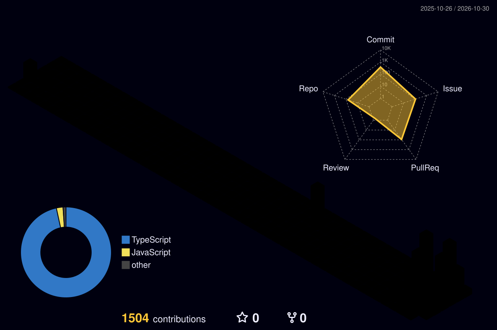

<p align="center">
  
</p>

<p align="center">
  
</p>

<p align="center">
  <a href="https://behloleaqil.com"></a>
  <a href="https://tools.dewelope.com"></a>
  <a href="mailto:behloleaqil@gmail.com"></a>
</p>

<p align="center">
  
  
</p>

---

## 🧑‍💻 About Me

I'm a full-stack engineer who builds products end to end, from **Spring Boot microservices** and **Node.js APIs** to **React** and **Next.js** frontends, with mobile work in **Flutter**. Lately I've been building AI-powered tools with **LangChain** and LLMs, and automating workflows with **Puppeteer**. Outside of work, I mentor and train students for free, helping them break into tech.

```js
const behlole = {
  role: "Full-Stack Software Engineer",
  backend: ["Java", "Spring Boot", "Node.js", "NestJS", "Laravel"],
  frontend: ["React", "Next.js", "Angular", "Tailwind"],
  mobile: ["Flutter"],
  ai: ["LangChain", "LLM apps", "Agent workflows"],
  cloud: ["AWS", "Docker"],
  building: ["LeadForge", "DeWelope"],
  portfolio: "https://behloleaqil.com",
  giveBack: "Mentoring students for free 🎓",
};
```

---

## 🔭 What I'm Working On

<table>
  <tr>
    <td width="50%" valign="top">
      <h3>⚡ LeadForge</h3>
      <p>A lead generation platform I'm currently building, from backend to UI.</p>
    </td>
    <td width="50%" valign="top">
      <h3>🧰 <a href="https://tools.dewelope.com">DeWelope Tools</a></h3>
      <p>A growing collection of online developer tools. Try them at <a href="https://tools.dewelope.com">tools.dewelope.com</a>.</p>
    </td>
  </tr>
</table>

---

## 🛠️ Tech Stack

<table>
  <tr>
    <td align="center"><b>Languages</b></td>
    <td></td>
  </tr>
  <tr>
    <td align="center"><b>Backend</b></td>
    <td></td>
  </tr>
  <tr>
    <td align="center"><b>Frontend & Mobile</b></td>
    <td></td>
  </tr>
  <tr>
    <td align="center"><b>Data, Cloud & Tools</b></td>
    <td></td>
  </tr>
</table>

---

## 🚀 Featured Projects

| Project | Description | Stack |
|---|---|---|
| [**DeWelope Tools**](https://tools.dewelope.com) | Online developer tools ([site repo](https://github.com/behloleaqil1/dewelope-site) · [tools repo](https://github.com/behloleaqil1/dewelope-tools)) | Web, JS |
| [**Binance Trader**](https://github.com/behloleaqil1/binance-trader) | Automated crypto trading bot with a [dashboard UI](https://github.com/behloleaqil1/binance-trader-ui) | Node.js, React |
| [**Spring Microservices**](https://github.com/behloleaqil1/Spring-Microservices) | Microservice architecture with Spring Boot | Java, Spring |
| [**E-commerce (Spring Boot + React)**](https://github.com/behloleaqil1/Ecommerce-SpringBoot-React) | Full-stack e-commerce platform | Java, React |
| [**Reddit Clone Backend**](https://github.com/behloleaqil1/reddit-clone-java-backend) | Reddit-style REST API | Java, Spring Security |
| [**Virtual Teacher**](https://github.com/behloleaqil1/virtualteacher) | E-learning platform ([frontend](https://github.com/behloleaqil1/vtfrontend) · [backend](https://github.com/behloleaqil1/vtbackend)) | Full-stack |
| [**Hotels In Pakistan**](https://github.com/behloleaqil1/HotelsInPakistan) | Hotel discovery and booking app | Web |
| [**Google Forms Auto Filler**](https://github.com/behloleaqil1/GoogleFormsAutoFiller) | Automation tool for filling Google Forms | Automation |

<p align="center"><a href="https://github.com/behloleaqil1?tab=repositories"><b>See all repositories →</b></a></p>

---

## 📊 GitHub Analytics

<table>
  <tr>
    <td width="50%"></td>
    <td width="50%"></td>
  </tr>
</table>

<p align="center">
  
</p>

### 📈 Contribution Activity

<p align="center">
  
</p>

### ⚡ Recent Activity

<!--START_SECTION:activity-->
1. 💪 Opened PR [#191](https://github.com/behloleaqil1/lair/pull/191) in [behloleaqil1/lair](https://github.com/behloleaqil1/lair)
2. 💪 Opened PR [#190](https://github.com/behloleaqil1/lair/pull/190) in [behloleaqil1/lair](https://github.com/behloleaqil1/lair)
3. 💪 Opened PR [#189](https://github.com/behloleaqil1/lair/pull/189) in [behloleaqil1/lair](https://github.com/behloleaqil1/lair)
4. 💪 Opened PR [#188](https://github.com/behloleaqil1/lair/pull/188) in [behloleaqil1/lair](https://github.com/behloleaqil1/lair)
5. ℹ️ Labeled issue [#187](https://github.com/behloleaqil1/lair/issues/187) in [behloleaqil1/lair](https://github.com/behloleaqil1/lair)
6. ❗ Opened issue [#187](https://github.com/behloleaqil1/lair/issues/187) in [behloleaqil1/lair](https://github.com/behloleaqil1/lair)
7. ❗ Opened issue [#186](https://github.com/behloleaqil1/lair/issues/186) in [behloleaqil1/lair](https://github.com/behloleaqil1/lair)
8. ℹ️ Labeled issue [#186](https://github.com/behloleaqil1/lair/issues/186) in [behloleaqil1/lair](https://github.com/behloleaqil1/lair)
<!--END_SECTION:activity-->

### 🐍 Contribution Snake

<p align="center">
  <picture>
    <source media="(prefers-color-scheme: dark)" srcset="https://raw.githubusercontent.com/behloleaqil1/behloleaqil1/output/github-snake-dark.svg" />
    
  </picture>
</p>

---

<p align="center"><b>⭐ Thanks for stopping by! Feel free to explore my work and reach out. ⭐</b></p>

<p align="center">
  
</p>
